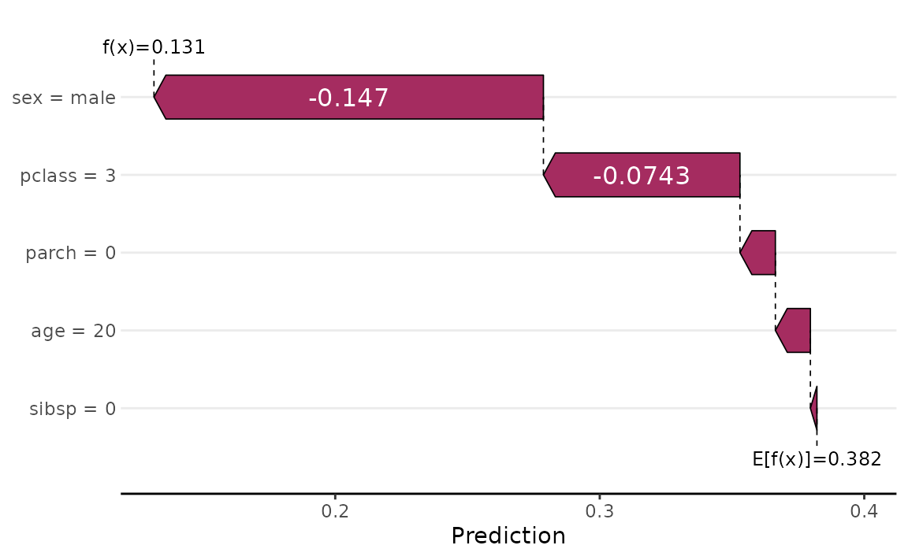
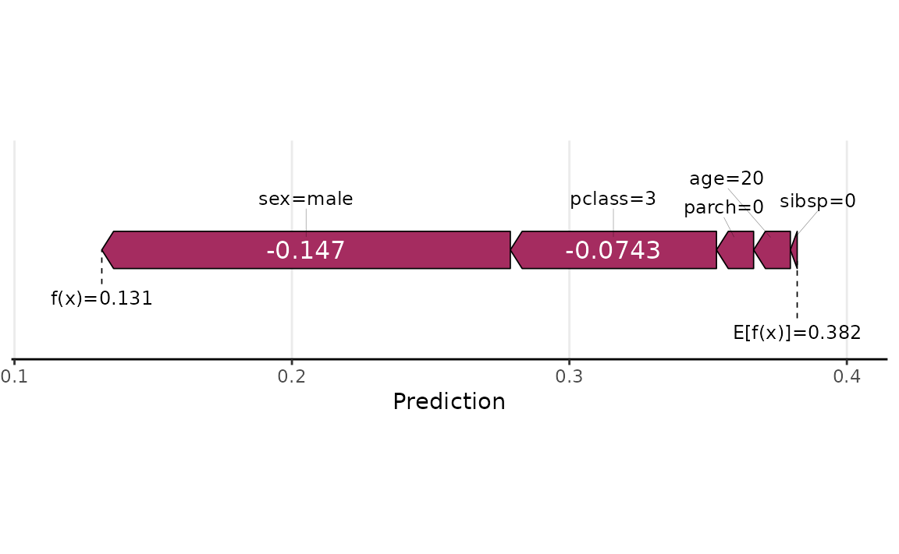
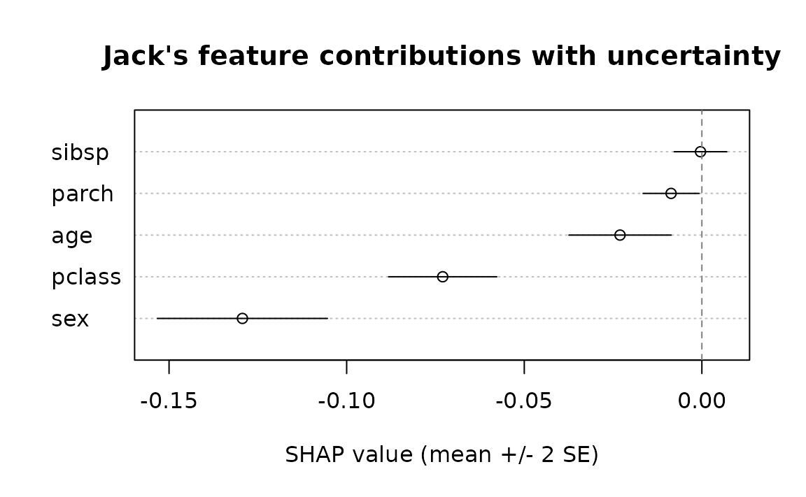
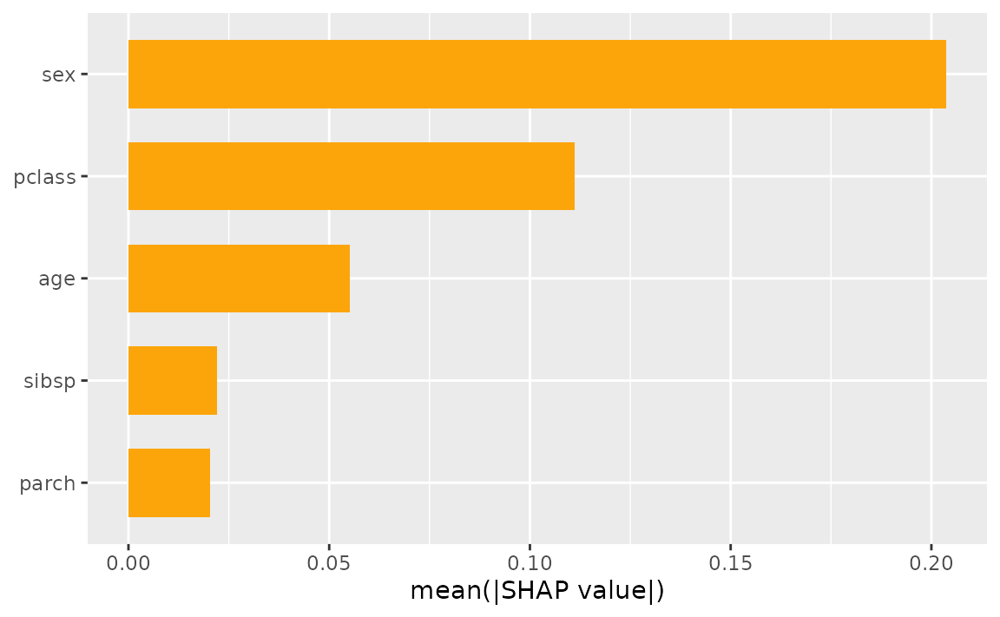
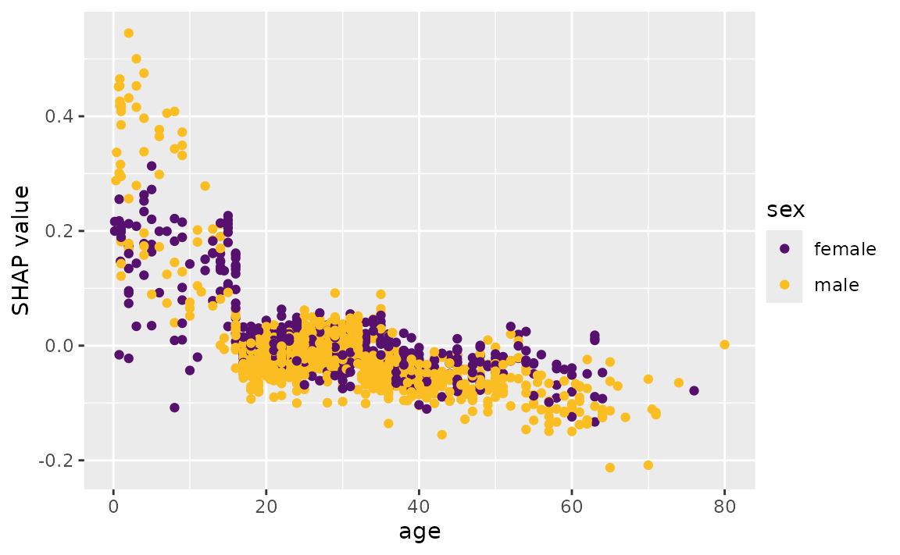
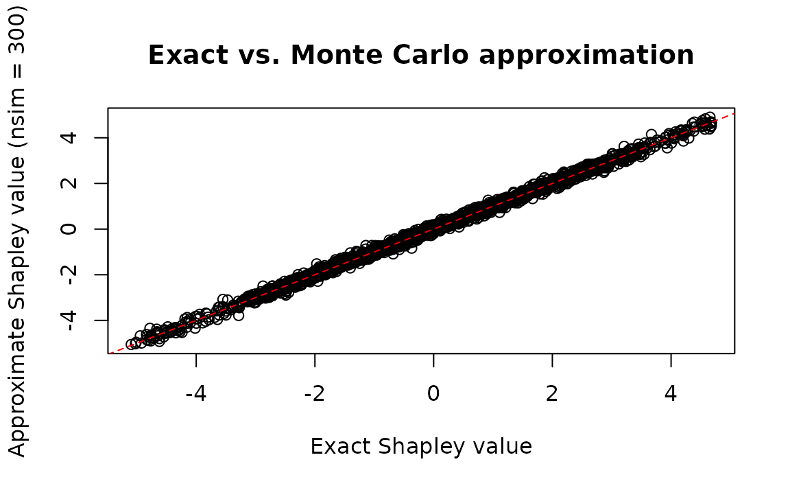

# fastshap

In this vignette, we’ll cover basic usage of
[fastshap](https://bgreenwell.r-universe.dev/fastshap) for computing
feature contributions for both local and global explanations, verify the
Monte Carlo approximation against exact Shapley values, and show how to
visualize the output using the
[shapviz](https://cran.r-project.org/package=shapviz) package. To start,
we’ll use the [ranger](https://cran.r-project.org/package=ranger)
package to build a random forest to predict (and explain) survivability
of passengers on the ill-fated Titanic.

The [source data](https://hbiostat.org/data/) (also available in
[`fastshap::titanic`](https://bgreenwell.github.io/fastshap/reference/titanic.md))
contains 263 missing values (i.e., `NA`’s) in the age column. The
`titanic_mice` version, which we’ll use in this vignette, contains
imputed values for the age column using *multivariate imputation by
chained equations* via the
[mice](https://cran.r-project.org/package=mice) package. Consequently,
`titanic_mice` is a list containing 11 imputed versions of the original
data; see
[`?fastshap::titanic_mice`](https://bgreenwell.github.io/fastshap/reference/titanic_mice.md)
for details. For now, we’ll just use one of the 11 imputed versions:

``` r

library(fastshap)

head(t1 <- titanic_mice[[1L]])
```

    ##   survived pclass   age    sex sibsp parch
    ## 1      yes      1 29.00 female     0     0
    ## 2      yes      1  0.92   male     1     2
    ## 3       no      1  2.00 female     1     2
    ## 4       no      1 30.00   male     1     2
    ## 5       no      1 25.00 female     1     2
    ## 6      yes      1 48.00   male     0     0

``` r

t1$pclass <- as.ordered(t1$pclass)  # makes more sense as an ordered factor
```

Next, we’ll build a default [*probability
forest*](https://doi.org/10.3414/ME00-01-0052) which uses the *Brier
score* to determine splits.

``` r

library(ranger)

set.seed(2053)  # for reproducibility
(rfo <- ranger(survived ~ ., data = t1, probability = TRUE))
```

    ## Ranger result
    ## 
    ## Call:
    ##  ranger(survived ~ ., data = t1, probability = TRUE) 
    ## 
    ## Type:                             Probability estimation 
    ## Number of trees:                  500 
    ## Sample size:                      1309 
    ## Number of independent variables:  5 
    ## Mtry:                             2 
    ## Target node size:                 10 
    ## Variable importance mode:         none 
    ## Splitrule:                        gini 
    ## OOB prediction error (Brier s.):  0.1337358

## Local explanations

To illustrate the simplest use of Shapley values for quantifying feature
contributions, we need an observation to predict. While we can use any
observation from the training set, we’ll construct an observation for a
new passenger. Everyone, meet Jack:

``` r

jack.dawson <- data.frame(
  #survived = 0L,  # in case you haven't seen the movie
  pclass = 3L,     # third-class passenger
  age = 20.0,      # twenty years old
  sex = factor("male", levels = c("female", "male")),  # male
  sibsp = 0L,      # no siblings/spouses aboard
  parch = 0L       # no parents/children aboard
)
```

Note that [fastshap](https://bgreenwell.r-universe.dev/fastshap), like
many other [machine learning
interpretability](https://christophm.github.io/interpretable-ml-book/)
packages (e.g., [iml](https://cran.r-project.org/package=iml)), requires
a user-specified prediction wrapper; that is, a simple function that
tells [fastshap](https://bgreenwell.r-universe.dev/fastshap) how to
extract the appropriate predictions from the fitted model. In this case,
we want to explain Jack’s likelihood of survival, so our prediction
wrapper[^1] needs to return the conditional probability of surviving
from a fitted [ranger](https://cran.r-project.org/package=ranger)
object; see
[`?ranger::predict.ranger`](http://imbs-hl.github.io/ranger/reference/predict.ranger.md)
for details:

``` r

pfun <- function(object, newdata) {  # prediction wrapper
  unname(predict(object, data = newdata)$predictions[, "yes"])
}

# Compute Jack's predicted likelihood of survival
(jack.prob <- pfun(rfo, newdata = jack.dawson))
```

    ## [1] 0.1314723

``` r

# Average prediction across all passengers
(baseline <- mean(pfun(rfo, newdata = t1)))
```

    ## [1] 0.3821045

``` r

# Difference between Jack and average
(difference <- jack.prob - baseline)
```

    ## [1] -0.2506322

Yikes, Jack isn’t predicted to have fared too well on this voyage, at
least compared to the baseline (i.e., average training prediction)! Can
we try to understand why Jack’s predicted likelihood of survival is so
much smaller than the average? Of course, this is the difference
Shapley-based feature contributions help to explain.

To illustrate, we’ll use the
[`explain()`](https://bgreenwell.github.io/fastshap/reference/explain.md)
function to estimate how each of Jack’s features (i.e., his age and sex)
contributed to the difference[^2]:

``` r

X <- subset(t1, select = -survived)  # features only
set.seed(2113)  # for reproducibility
(ex.jack <- explain(rfo, X = X, pred_wrapper = pfun, newdata = jack.dawson,
                    nsim = 300))
```

    ##           pclass         age        sex       sibsp       parch
    ## [1,] -0.06927731 -0.03321149 -0.1386586 0.006124086 -0.01045127
    ## attr(,"baseline")
    ## [1] NA
    ## attr(,"class")
    ## [1] "explain" "matrix"  "array"

The [fastshap](https://bgreenwell.r-universe.dev/fastshap) package uses
an efficient version of the Monte Carlo (MC) algorithm described in
Strumbelj and Kononenko (2014). Consequently, for stability and
accuracy, the feature contributions should be computed many times and
the results averaged together; as of version 0.2.0,
[`explain()`](https://bgreenwell.github.io/fastshap/reference/explain.md)
batches these repetitions into a small number of (large) prediction
calls, so increasing `nsim` is far cheaper than it used to be.

Note that the MC approach used by
[fastshap](https://bgreenwell.r-universe.dev/fastshap) (and other
packages) will not produce Shapley-based feature contributions that
satisfy the [efficiency
property](https://christophm.github.io/interpretable-ml-book/shapley.html#the-shapley-value-in-detail);
that is, they won’t add up to the difference between the corresponding
prediction and baseline. However, borrowing a trick from the popular
Python [shap](https://github.com/shap/shap) library, we can use a
regression-based adjustment to correct the sum. To do this, simply set
`adjust = TRUE` in the call to
[`explain()`](https://bgreenwell.github.io/fastshap/reference/explain.md)[^3]:

``` r

set.seed(2133)  # for reproducibility
(ex.jack.adj <- explain(rfo, X = X, pred_wrapper = pfun, newdata = jack.dawson,
                        nsim = 300, adjust = TRUE))
```

    ##           pclass         age        sex        sibsp       parch
    ## [1,] -0.07429336 -0.01323978 -0.1472409 -0.002466615 -0.01339153
    ## attr(,"baseline")
    ## [1] 0.3821045
    ## attr(,"class")
    ## [1] "explain" "matrix"  "array"

``` r

# Sanity check
sum(ex.jack.adj)
```

    ## [1] -0.2506322

``` r

difference
```

    ## [1] -0.2506322

Next, we can use the
[shapviz](https://cran.r-project.org/package=shapviz) package to produce
several useful visualizations for either a vector or matrix of Shapley
values. Below, we create a simple waterfall chart to visualize how
Jack’s features contributed to his relatively low predicted probability
of surviving:

``` r

library(shapviz)

shv <- shapviz(ex.jack.adj, X = jack.dawson, baseline = baseline)
sv_waterfall(shv)
```



Clearly, the fact that Jack was a male, third-class passenger
contributed the most to pushing his predicted probability of survival
down below the baseline. *Force plots* are another popular way to
visualize Shapley values for explaining a single prediction:

``` r

sv_force(shv)
```



## Raw Shapley values and Monte Carlo uncertainty

By default,
[`explain()`](https://bgreenwell.github.io/fastshap/reference/explain.md)
returns the averaged Shapley values across all Monte Carlo simulations.
Setting `raw = TRUE` gives you the full per-simulation results as a 3-D
array of dimensions **n x p x nsim** (observations x features x
simulations). This is useful for quantifying Monte Carlo (MC)
uncertainty: once you have the raw draws, the MC standard error of each
Shapley estimate is just an
[`apply()`](https://rdrr.io/r/base/apply.html) away.

``` r

set.seed(2140)  # for reproducibility
raw.jack <- explain(rfo, X = X, pred_wrapper = pfun, newdata = jack.dawson,
                    nsim = 300, raw = TRUE)

dim(raw.jack)  # 1 observation x 5 features x 300 simulations
```

    ## [1]   1   5 300

Compute the mean and standard error across the simulations for each
feature, then produce a simple dot-and-whisker plot (mean +/- 2 SE) with
base graphics:

``` r

shap.mean <- apply(raw.jack, 1:2, mean)  # same as plain explain() output
shap.se   <- apply(raw.jack, 1:2, sd) / sqrt(dim(raw.jack)[3L])

feature.order <- order(shap.mean)
xlim <- range(c(shap.mean - 2 * shap.se, shap.mean + 2 * shap.se))

dotchart(as.numeric(shap.mean)[feature.order],
        labels = colnames(shap.mean)[feature.order],
        xlim = xlim, xlab = "SHAP value (mean +/- 2 SE)",
        main = "Jack's feature contributions with uncertainty")
abline(v = 0, lty = 2, col = "grey50")
segments(
  x0 = (shap.mean - 2 * shap.se)[1L, feature.order],
  x1 = (shap.mean + 2 * shap.se)[1L, feature.order],
  y0 = seq_along(feature.order)
)
```



With 300 simulations all five features are estimated fairly precisely —
the narrow MC error bars suggest the algorithm has largely converged.
Features with larger absolute contributions (`sex`, `pclass`) carry
proportionally more per-simulation variance, but dividing by
$`\sqrt{n_{\text{sim}}}`$ keeps the standard error small at this sample
size.

## Global explanations

Aside from explaining an individual prediction (i.e., *local
explanation*), it can be useful to aggregate the results of several
(i.e., all of the training predictions) into an overall global summary
about the model (i.e., *global explanation*). The code chunk below
computes Shapley explanations for each passenger in the training data:

``` r

set.seed(2224)  # for reproducibility
ex.t1 <- explain(rfo, X = X, pred_wrapper = pfun, nsim = 30, adjust = TRUE,
                 shap_only = FALSE)
round(head(ex.t1$shapley_values), 3)
```

    ##      pclass    age    sex  sibsp  parch
    ## [1,]  0.209  0.046  0.316  0.000 -0.010
    ## [2,]  0.101  0.316 -0.036  0.011  0.087
    ## [3,]  0.170  0.092  0.060 -0.026 -0.045
    ## [4,]  0.197 -0.029 -0.183  0.020  0.029
    ## [5,]  0.187 -0.025  0.295 -0.016 -0.041
    ## [6,]  0.157 -0.032 -0.174 -0.016 -0.008

Note that we set the optional argument `shap_only = FALSE` here. This is
a convenience argument when working with
[shapviz](https://cran.r-project.org/package=shapviz); in short, setting
this to `FALSE` returns a list containing the Shapley values, feature
values, and baseline (all of which can be used by
[shapviz](https://cran.r-project.org/package=shapviz)’s plotting
functions).

A common global measure computed from Shapley values is the
Shapley-based feature importance score, which is nothing more than the
mean of the absolute value of the feature’s contribution across
observations:

``` r

shv.global <- shapviz(ex.t1)
sv_importance(shv.global)
```



Another common global visualization is the Shapley dependence plot, akin
to a [*partial dependence
plot*](https://cran.r-project.org/package=pdp). Here, we’ll look at the
dependence of the feature contribution of `age` on its input value:

``` r

sv_dependence(shv.global, v = "age")
```



## Exact vs. approximate Shapley values

For linear models,
[xgboost](https://cran.r-project.org/package=xgboost), and
[lightgbm](https://cran.r-project.org/package=lightgbm) models,
[`explain()`](https://bgreenwell.github.io/fastshap/reference/explain.md)
can also compute *exact* Shapley values (`exact = TRUE`) instead of the
Monte Carlo approximation. This is a useful way to sanity check the
approximation: with enough simulations, the two should agree closely.
We’ll use the Friedman 1 benchmark data
([`gen_friedman()`](https://bgreenwell.github.io/fastshap/reference/gen_friedman.md))
and a plain linear model, whose features are independent by
construction:

``` r

set.seed(101)
trn <- gen_friedman(500)  # 10 features, only 5 of which matter
X.friedman <- subset(trn, select = -y)

fit.lm <- lm(y ~ ., data = trn)
pfun.lm <- function(object, newdata) predict(object, newdata = newdata)

ex.exact <- explain(fit.lm, X = X.friedman, exact = TRUE)
set.seed(102)
ex.approx <- explain(fit.lm, X = X.friedman, pred_wrapper = pfun.lm, nsim = 300)

plot(as.numeric(ex.exact), as.numeric(ex.approx),
    xlab = "Exact Shapley value", ylab = "Approximate Shapley value (nsim = 300)",
    main = "Exact vs. Monte Carlo approximation")
abline(0, 1, col = "red2", lty = 2)
```



``` r

cor(as.numeric(ex.exact), as.numeric(ex.approx))
```

    ## [1] 0.9983586

As expected, the Monte Carlo approximation tracks the exact Shapley
values closely.

## An alternative Monte Carlo estimator: permutation walks

By default,
[`explain()`](https://bgreenwell.github.io/fastshap/reference/explain.md)
uses the Strumbelj and Kononenko (2014) estimator described above, which
draws independent random coalitions for each feature. Setting
`method = "permutation"` switches to a different (also unbiased)
estimator that walks a single random permutation through *all* features
per replication, flipping one feature at a time from background to
foreground and reading off each feature’s contribution as the difference
between consecutive predictions. This computes every feature’s
contribution from roughly half as many predictions as the default
estimator, and each replication’s contributions sum *exactly* to the
difference between the prediction and the background average (so
`adjust = TRUE`, which corrects for the lack of that property under the
default estimator, is not applicable here).

Reusing the linear model and background data from above:

``` r

set.seed(103)
ex.perm <- explain(fit.lm, X = X.friedman, pred_wrapper = pfun.lm, nsim = 300,
                   method = "permutation")

cor(as.numeric(ex.exact), as.numeric(ex.perm))
```

    ## [1] 0.998355

The two Monte Carlo estimators agree with each other (and with the exact
values) up to simulation noise. One practical difference:
`method = "permutation"` always computes contributions for *every*
feature internally (the telescoping property requires walking the full
permutation), so unlike the default estimator, requesting a subset via
`feature_names` only trims the *output* — it doesn’t reduce the amount
of work performed. The default estimator remains the better choice when
only a handful of features are of interest; the permutation-walk
estimator is the better choice when explaining all (or most) features at
once.

## Main, total, and interaction effects

The Friedman 1 benchmark also bakes in a real pairwise interaction
between `x1` and `x2` (`10 * sin(pi * x1 * x2)`). While
[`explain()`](https://bgreenwell.github.io/fastshap/reference/explain.md)
estimates Shapley values by averaging over *randomly sampled*
coalitions,
[`explain_effects()`](https://bgreenwell.github.io/fastshap/reference/explain_effects.md)
decomposes each feature’s contribution into a `main` effect (its effect
in isolation — equivalent to the centered partial dependence of that
feature), a `total` effect (main effect plus every interaction it
participates in), and the gap between them (`interaction`), using only
the two highest-weight coalitions. By default this involves no Monte
Carlo simulation at all: it averages over the entire background data
set.

We’ll fit a multivariate adaptive regression spline
([earth](https://cran.r-project.org/package=earth)) with `degree = 2` so
the fitted model can actually capture the `x1:x2` interaction:

``` r

library(earth)

fit.mars <- earth(y ~ ., data = trn, degree = 2)
pfun.mars <- function(object, newdata) predict(object, newdata = newdata)[, 1L]

eff <- explain_effects(fit.mars, X = X.friedman, pred_wrapper = pfun.mars)

# Mean absolute interaction strength per feature
round(colMeans(abs(eff$interaction)), 3)
```

    ##    x1    x2    x3    x4    x5    x6    x7    x8    x9   x10 
    ## 1.064 1.064 0.000 0.000 0.000 0.000 0.000 0.000 0.000 0.000

The interaction diagnostic correctly flags `x1` and `x2` as the only
features with meaningful interaction content — exactly the pair baked
into the Friedman 1 formula — while `x3`-`x10` show essentially none.

## Parallel processing

The
[`explain()`](https://bgreenwell.github.io/fastshap/reference/explain.md)
function computes Shapley values one feature at a time, batching all
Monte Carlo repetitions for that feature into a couple of prediction
calls. If you have a lot of features and an expensive `pred_wrapper`, it
may still be beneficial to run
[`explain()`](https://bgreenwell.github.io/fastshap/reference/explain.md)
in parallel across features. Setting `parallel = TRUE` uses
[foreach](https://cran.r-project.org/package=foreach) to loop through
features, so you can use any parallel backend it supports (this requires
the foreach package to be installed).

We use [`makeCluster()`](https://rdrr.io/r/parallel/makeCluster.html) +
[`registerDoParallel()`](https://rdrr.io/pkg/doParallel/man/registerDoParallel.html)
here because it works on all platforms (including Windows). Note the
`.packages = "ranger"` argument: on socket-based clusters (the default
on Windows), worker processes don’t inherit packages loaded in the main
session, so any packages needed by the prediction wrapper must be
declared explicitly via `...`, which
[`explain()`](https://bgreenwell.github.io/fastshap/reference/explain.md)
forwards to [`foreach()`](https://rdrr.io/pkg/foreach/man/foreach.html)
(fastshap’s own namespace is always added to `.packages` automatically).
If fastshap (or ranger) is installed somewhere other than the default
library path — as happens, for instance, when building this vignette
from a development checkout — the workers also need to be told where to
look via [`.libPaths()`](https://rdrr.io/r/base/libPaths.html):

``` r

library(doParallel)

cl <- makeCluster(2L)  # adjust to the number of cores available on your machine
invisible(clusterCall(cl, function(lp) .libPaths(lp), .libPaths()))
registerDoParallel(cl)
set.seed(5038)
ex.par <- explain(rfo, X = X, pred_wrapper = pfun, nsim = 30,
                  adjust = TRUE, parallel = TRUE, .packages = "ranger")
stopCluster(cl)

# Results are consistent with the sequential run above
cor(as.numeric(ex.par), as.numeric(ex.t1$shapley_values))
```

    ## [1] 0.9656705

## References

Strumbelj, E., and Kononenko, I. (2014). Explaining prediction models
and individual predictions with feature contributions. *Knowledge and
Information Systems*, 41(3), 647-665.

[^1]: As described in
    [`?fastshap::explain`](https://bgreenwell.github.io/fastshap/reference/explain.md),
    the prediction wrapper requires two arguments, `object` and
    `newdata`.

[^2]: Note that we need to supply the training features via the `X`
    argument (i.e., no response column) and that `newdata` should also
    only contain columns of feature values.

[^3]: Note that `nsim` has to be larger than one whenever setting
    `adjust = TRUE`.
